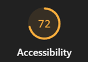
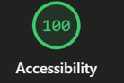

# Auditoría UX: App de notas

## 1. Auditoría con las 5 heurísticas de Nielsen

| Heurística | Problema (antes) | Solución (después) |
|---|---|---|
| Visibilidad del estado | Al agregar, borrar una nota o pulsar BORRAR TODAS no aparece ningún mensaje: no sé si la acción funcionó. | Mensaje visible después de cada acción («Nota agregada», «Nota eliminada») con `role="status"`. |
| Coincidencia con el mundo real | El botón dice ok, el título habla como sistema APLICACION DE GESTION DE NOTAS PERSONALES y la pestaña se llama notas. | Botón «Agregar nota», título «Mis notas» y mensajes en lenguaje cotidiano. |
| Control y libertad | La x y BORRAR TODAS borran al instante, sin confirmar ni poder deshacer. | Confirmación antes de borrar todo y botón «Deshacer» después de eliminar una nota. |
| Prevención de errores | Deja agregar notas vacías. | El botón no agrega si el campo está vacío y se muestra el motivo antes de guardar, no después. |
| Reconocer, no recordar | El campo solo tiene un placeholder que desaparece al escribir. | `<label>` visible «Escribe tu nota» y un contador de notas guardadas. |

## 2. Leyes de usabilidad

- **Ley de Fitts:** el botón «Agregar nota» pasó de 9px a un botón grande (mínimo 44px de alto) y «Borrar todas» quedó separado de las acciones comunes, para no pulsarlo por error.
- **Ley de Hick:** se agrega una lista de categorías con solo 3 opciones (Personal, Estudio, Trabajo), en lugar de dejar al usuario decidir cómo ordenar todo.
- **Ley de Miller:** las notas se agrupan por categoría en bloques cortos, para no obligar a recordar una lista larga y desordenada.

## 3. Accesibilidad y diseño visual

- Colores definidos con variables CSS en `:root`.
- Texto con contraste mayor a 4.5:1 (antes `#b5b5b5` sobre blanco, menos de 2:1).
- Foco visible con `:focus-visible` (antes `outline: none`).
- Un solo `<h1>` y espaciado en múltiplos de 8px.
- `alt` en la imagen y botones de al menos 44px.

## 4. Lighthouse (Accesibilidad)

- 
- 
